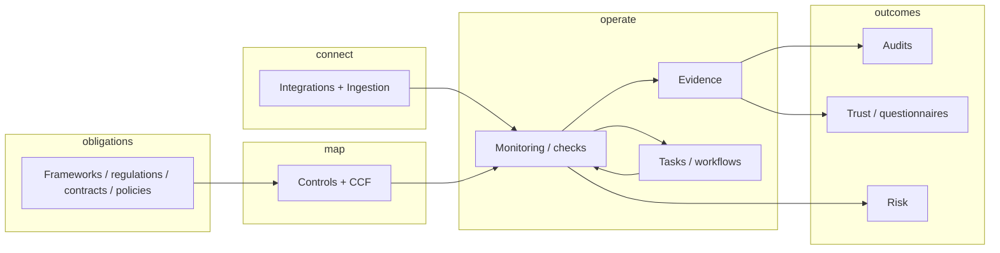

# Sprinto: scope and use cases (reverse-engineered)

This document summarizes Sprinto’s product scope and typical use cases, reverse-engineered from public positioning ([sprinto.com](https://sprinto.com)), pricing pages, feature descriptions, and [Sprinto Docs](https://docs.sprinto.com) (integrations, dashboard, ingestion). It is not official Sprinto documentation.

## What Sprinto is

Sprinto positions itself as an **Autonomous Trust Platform**: a cloud-native **GRC (governance, risk, and compliance)** product aimed primarily at **startups and mid-market** companies that need **continuous compliance and trust operations**, not a one-time audit project.

**Typical buyers:** founders, CIO/CISO, security engineers, and first compliance hires at SaaS, health tech, fintech, and similar vendors selling into enterprises.

**Claimed scale (marketing):** 200+ frameworks, 300+ integrations, 4,000+ customers.

---

## Problem domain

| Domain | Sprinto’s stated focus |
|--------|-------------------------|
| Security & privacy compliance | SOC 2, ISO 27001, HIPAA, GDPR, PCI DSS, NIST, 200+ frameworks; custom frameworks from contracts/regulations |
| Audit lifecycle | Scope, control mapping, evidence, auditor collaboration, rolling audit packs |
| Operational security posture | Automated checks on cloud, IAM, code repos, devices, HR lifecycle |
| Third-party risk (TPRM) | Vendor discovery, tiering, diligence workflows, questionnaires |
| Enterprise risk (ERM) | Risk register, treatments, heatmaps tied to live signals |
| External trust | Trust Center, security questionnaires, customer-facing posture |
| AI governance | Shadow-AI discovery, registry, mapping to ISO 42001, NIST AI RMF, EU AI Act |

**Out of scope (inferred):** Not marketed as a replacement for SIEM, full CSPM, DLP, or deep application security testing—those systems usually act as **integration sources** for checks and evidence.

---

## Platform mental model

Sprinto describes a continuous loop:

1. **Unified commitments** — Frameworks, regulations, customer contracts, and internal policies are interpreted into **controls** and kept aligned.
2. **Common / secure control framework (CCF)** — Define controls once; **reuse and cross-map** across multiple frameworks.
3. **Integrations & ingestion** — Native connectors plus API/file/webhook **ingestion plans** pull data from cloud, IAM, HR, repos, MDM, vuln tools, ITSM, etc.
4. **Sprinto checks** — Automated evaluations (mostly **read-only** integration data: configs, users, branch protection, device posture) mapped to control requirements.
5. **Evidence** — Auto-collected, tagged; **signed / tamper-evident** artifacts where advertised; unified evidence library.
6. **Tasks & remediation** — Failures become owned work (SLAs, Slack/Teams, Jira sync); optional autonomous fixes (“Fix-It” style) on connected systems.
7. **Outcomes** — Audit readiness, trust center / questionnaires, live risk posture.

---

## Product modules (from Sprinto Docs navigation)

| Module | Purpose |
|--------|---------|
| **Dashboard** | Control health, pending compliance tasks, continuous risk monitoring |
| **Compliance** | Frameworks, controls, baselines, resources |
| **Monitoring** | Configure and review automated Sprinto checks |
| **Policies** | Policy lifecycle and employee acknowledgements |
| **Risks** | Risk register, scoring, treatments, effectiveness |
| **Audits** | Ongoing/planned audits, evidence, auditor requests |
| **Data Library** | Assets, incidents, related documentation |
| **Trust** | Trust Center, questionnaires, disclosures |
| **Settings** | Integrations, **zones** (multi-entity scoping), roles, org security |
| **Ingestion** | Workflow engine: plans, providers, credentials, scheduled sync, webhooks |

### Commercial modules (pricing tiers / add-ons)

- **Foundation** — Core compliance automation, frameworks, evidence collection.
- **Continuous Compliance** — Deeper autonomous monitoring, gap closure, org-specific automation (rule engine, custom API checks).
- **Enterprise TPRM** — Third-party risk at scale.
- **Enterprise Risk Management** — Risk register linked to audits, vendors, scans.
- **Enterprise Trust Management** — Trust Center and questionnaire scale-out for sales.

Professional services are offered for first audit / program setup.

### AI capabilities (marketing)

- Gap analysis and evidence assistance
- Audit prep automation
- **Agent Playground / Ask AI** — low-code agents and conversational queries
- Vendor diligence playbooks

### People and endpoints

- **People Ops** — Joiner/mover/leaver tied to control evidence
- **Doctor Sprinto MDM** — Device monitoring and audit-ready endpoint evidence

---

## Integration architecture (inferred)

- **300+ native integrations** across cloud (AWS, GCP, Azure), IdP (Google Workspace, Microsoft 365), VCS (GitHub, GitLab, Bitbucket, Azure DevOps), HRIS, vuln scanners, ITSM, incident tools, CRM, etc.
- Partners such as **Merge** and **Truto** used for some connector mapping.
- **Permissions model:** predominantly **read-only** access to evaluate configuration and identity metadata; selective **write** for Slack/Teams notifications, Jira tickets, AWS CloudWatch alarms, etc. (documented per provider in Sprinto Docs).
- **Ingestion module:** configurable **plans** — authenticate → fetch/receive → transform → map to Sprinto entities → trigger checks/workflows; supports **webhooks** and scheduled sync for custom systems.

---

## Use cases by situation

### 1. First certification (“compliance operator”)

- **Trigger:** Enterprise deal requires SOC 2 / ISO 27001; no dedicated GRC team.
- **Flow:** Select framework → pre-mapped controls and template policies → connect stack → gap list → tasks → audit readiness.
- **Outcome:** First audit without spreadsheet-heavy program management.

### 2. Continuous compliance after first audit

- **Trigger:** Multiple frameworks (SOC 2 + ISO + HIPAA), overlapping audit cycles.
- **Flow:** Cross-map controls; 24/7 monitoring; auto evidence refresh; tiered alerts and SLAs; policy drift detection.
- **Outcome:** Avoid periodic “audit fire drills”; live control health.

### 3. Multi-framework and multi-entity

- **Trigger:** New products, regions, subsidiaries.
- **Flow:** Zones; shared CCF; upload custom regulations/contracts → translated to controls; entity-wide or granular dashboards.
- **Outcome:** One program, many obligations.

### 4. Audit management

- **Trigger:** External auditor needs scoped, verifiable evidence.
- **Flow:** Audit scope → auto-mapped proof → secure auditor access → tracked requests → rolling audit packs / event logs.
- **Outcome:** Shorter reviews; centralized evidence.

### 5. Sales and trust (GTM)

- **Trigger:** Security questionnaires and reviews block deals.
- **Flow:** Trust Center synced from verified posture; AI-assisted questionnaire responses.
- **Outcome:** Reduce security team bottleneck on every prospect.

### 6. Vendor / supply-chain risk

- **Trigger:** SOC 2 vendor questions; shadow SaaS; renewal-time diligence.
- **Flow:** Discover vendors → tier risk → automated diligence and follow-ups → documented register.
- **Outcome:** Current TPRM, not annual questionnaires only.

### 7. Enterprise risk for leadership

- **Trigger:** Board/insurance needs current risk view.
- **Flow:** Risks linked to audits, vendors, vulnerabilities, control failures; heatmaps and residual risk from live signals.
- **Outcome:** Register reflects current state.

### 8. AI governance

- **Trigger:** Shadow AI tools; ISO 42001 / EU AI Act pressure.
- **Flow:** Detect AI adoption → registry → classify by data sensitivity → map to AI frameworks.
- **Outcome:** AI footprint visible alongside classic GRC.

### 9. Custom obligations

- **Trigger:** Customer security exhibit or niche standard not in catalog.
- **Flow:** Upload obligation → map to controls → integrate with existing CCF (surface net-new work only).
- **Outcome:** Contractual requirements treated like frameworks.

### 10. Custom automation

- **Trigger:** Internal or niche systems must feed compliance.
- **Flow:** Sprinto API, custom checks, ingestion plans, webhooks, Jira Active Sync, programmable workflows.
- **Outcome:** Same control model for bespoke infrastructure.

---

## Positioning vs traditional GRC (Sprinto’s narrative)

| Area | Traditional GRC (as contrasted) | Sprinto |
|------|----------------------------------|---------|
| Multiple frameworks | New project per framework | Auto-mapped, shared controls |
| Evidence | Basic collection | AI-assisted collection and gap analysis |
| Vendor risk | Questionnaire emails | End-to-end diligence |
| Audit prep | Reminders | Continuous, AI-assisted readiness |
| AI governance | Policy documents | Live registry and real-time risk |
| Human role | Running the program | Approving decisions; platform executes |

---

## Boundaries and assumptions

- Value depends on **connected systems**; manual or air-gapped environments reduce automation benefits.
- Checks emphasize **configuration and metadata**, not full content inspection of application data (stated for several cloud/VCS integrations).
- Target sweet spot: **fast-growing technology vendors** rather than full-tier-1 bank GRC replacements.

---

## Sources (public)

- [Sprinto homepage](https://sprinto.com/)
- [Continuous compliance](https://sprinto.com/continuous-compliance/)
- [Frameworks](https://sprinto.com/frameworks/)
- [Audit management](https://sprinto.com/products/audit-management-platform/)
- [Features / Sprinto AI](https://sprinto.com/features/)
- [Pricing](https://sprinto.com/pricing/)
- [Sprinto Docs — Dashboard](https://docs.sprinto.com/dashboard/overview)
- [Sprinto Docs — Integrations](https://docs.sprinto.com/integrations/overview)
- [Sprinto Docs — Ingestion](https://docs.sprinto.com/ingestion/overview)
- [Sprinto Docs — Integration permissions](https://docs.sprinto.com/integrations/overview/permissions-and-resource-usage-in-sprinto-integrations)

---

*Generated for internal reference in this repository. Verify against official Sprinto materials before contractual or procurement decisions.*
