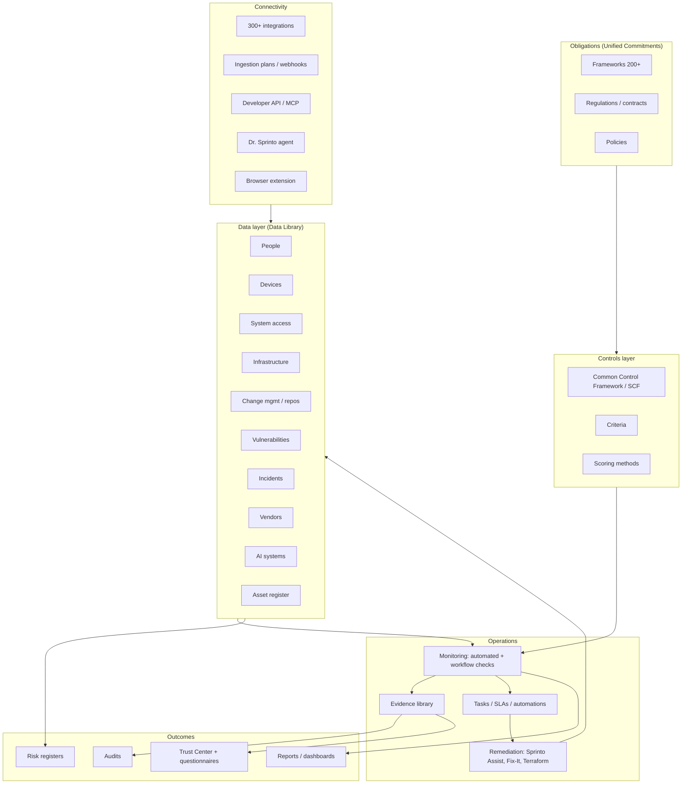

# Sprinto — Product Scope

Reverse-engineered scope of the Sprinto platform. Sources: sprinto.com (homepage, features, pricing, product pages), docs.sprinto.com (module docs, sitemap, integrations, Developer API), and independent 2026 comparisons of Sprinto against Vanta, Drata, Secureframe and Thoropass. This is not official Sprinto documentation. Use cases are documented separately in [`use-cases/`](./use-cases/README.md).

---

## 1. Positioning

| Aspect | Observation |
|--------|-------------|
| Category | Compliance automation / GRC, marketed as an **"Autonomous Trust Platform"** |
| Core promise | Continuous compliance that *executes* (closes gaps, refreshes evidence, routes approvals) rather than only alerting |
| Target segment | Cloud-native startups and mid-market; "Series A to enterprise"; strong footprint in India/SE Asia and price-sensitive buyers |
| Primary buyers | Founders/CTOs needing a first SOC 2 or ISO 27001, then security/GRC leads running multi-framework programs |
| Market peers | Vanta, Drata, Secureframe, Thoropass (plus legacy GRC suites) |
| Differentiation claimed | 200+ frameworks, 300+ integrations, cross-framework control reuse, autonomous TPRM, AI governance, lower price point |
| Differentiation observed by third parties | Cheaper and simpler than Vanta/Drata; smaller integration depth and auditor network; thinnest public disclosure (framework list, integration count, tier naming) |

### Growth stages Sprinto explicitly designs for

1. **First compliance operator** — no one owns compliance; Sprinto scopes SOC 2 / ISO 27001 / HIPAA and gets the company audit-ready.
2. **Trust ops on autopilot** — multiple frameworks, overlapping audits, customer questionnaires; run as a continuous program.
3. **Defensible trust posture at scale** — vendors, shadow AI, regulatory change, regional nuance; continuously validated posture across compliance, AI governance and vendor risk.

---

## 2. Problem domain boundaries

### In scope

| Domain | Coverage |
|--------|----------|
| Security & privacy compliance | SOC 2, ISO 27001/27701/27017/27018, HIPAA, GDPR/UK-GDPR, CCPA/CPRA, PIPEDA, PCI DSS, NIST, ISO 9001, ISO 42001, CSA STAR, FedRAMP/CMMC mapping; custom frameworks; SCF (Secure Controls Framework) backbone |
| Audit lifecycle | Audit planning, auditor network, BYOA, internal audits, findings & remediation tracker, audit partner API (e.g. A-LIGN) |
| Control monitoring | Automated checks against cloud, IAM/IdP, VCS, MDM/EDR, HR, ticketing, scanners; workflow (manual, time-driven) checks; programmable monitors |
| Evidence | Unified evidence library, versioning, bulk/CSV upload, AI gap analysis, signed/tamper-evident artifacts, browser-extension capture |
| Policies | Templates, in-app editor, versioning, multi-step approvals, acknowledgement campaigns (incl. Slack), Confluence/Drive sync |
| People | Staff scoping, onboarding/offboarding, training campaigns (built-in, KnowBe4, Curricula, Workday LMS), BGV, org charts, Employee Portal |
| Access management | Critical systems, access registers, user access reviews, ticket-based access validation, offboarding revocation |
| Devices | Dr. Sprinto agent (macOS/Windows/Linux), MDM integrations (Intune, Jamf, Kandji, JumpCloud, Hexnode, …), manual device reporting |
| Change management | Repo classification, branch protection, PR review checks, ticket-based change management |
| Vulnerabilities | Scanner ingestion, pentest report upload, SLA tracking, special-case exceptions |
| Infrastructure | Cloud asset discovery, prod/non-prod classification, owners, 70+ AWS checks, Azure/GCP/DigitalOcean/others |
| Incidents | Incident sources (PagerDuty, Defender, Freshservice…), resolution checks |
| Asset register | Unified infra, devices, code repos, staff, systems; link to risks |
| Risk management | ISO 27005-aligned register, risk library, scoring (custom/weighted), treatments, multiple registers, zones, continuous risk monitoring, risk intake |
| Third-party risk (TPRM) | Vendor discovery (SSO, browser, MDM, API), inventory, tiering, due diligence, AI document review, questionnaires, vendor portal, breach monitoring, Risk Pulse |
| Trust management | Trust Center (custom domain, NDA gating, DocuSign/HelloSign, multiple centers), security questionnaire automation (AI + Chrome extension), knowledge hub, DSR portal, responsible disclosure |
| AI governance | AI Systems inventory, shadow-AI discovery, AI risk scoring, due diligence, violations, mapping to ISO 42001 / NIST AI RMF / EU AI Act |
| Privacy | DPIA management, data-rights requests, privacy frameworks |
| Platform & extensibility | Zones (multi-entity), RBAC, SSO, approval paths, automation rules, custom fields, SLAs, activity log, Developer API (GraphQL), Ingestion (plans/webhooks/YAML/AI editor), custom integration push APIs, Sprinto MCP, Jira Active Sync |
| AI layer | Sprinto AI Playground (custom AI actions), Ask AI, Sprinto Assist (fix failing monitors, connect integrations, answer questionnaires), AI policy/control mapping, AI evidence gap analysis, Fix-It agent, Terraform-based remediation |

### Out of scope / adjacent (inferred)

- Not a SIEM, CSPM, EDR, DLP or vulnerability scanner; these are **sources** (Wiz, CrowdStrike, Security Hub, Defender, Dependabot, etc.).
- Does not perform the audit itself (unlike Thoropass); auditors come from the Sprinto network or BYOA.
- Reads **configuration and identity metadata**, not application data or source code content (explicitly stated for AWS, GCP, Azure, VCS integrations).
- Limited write-back: notifications (Slack/Teams), tickets (Jira and others), CloudWatch alarms, and opt-in remediation agents.

---

## 3. Capability map

---

## 4. Product modules (as exposed in the app)

| Navigation area | Sub-modules / key objects |
|-----------------|---------------------------|
| **Dashboard** | Control Health, Task Dashboard, Continuous Risk Monitoring |
| **Audits** | Audits (automated/partner/custom), audit tasks, scoring, lifecycle reporting, Evidences |
| **Policies** | Policies & documents, versions, approval paths, policy registers, acknowledgements, policy monitoring checks |
| **Risks** | Risk registers, scoring, treatments, assessments, risk intake, zones |
| **Compliance** | Frameworks, Criteria, Controls, Compliance Documents |
| **Data Library** | People, Trainings, Staff Devices, System Access, Vendors, DPIA, AI Systems, Change Management, Vulnerabilities, Infrastructure, Incidents, Asset Register, Reviews, Workflow Checks |
| **Monitoring** | Monitor table, automated checks (rule builder), single workflow checks, Jira sync, AI evidence gap analysis, special cases |
| **Ingestion** | Plans, entity types, webhooks, YAML/AI editors, run history |
| **Trust** | Trust Center, Questionnaires, Knowledge Hub, Responsible Disclosure |
| **Sprinto AI** | AI Playground, AI Actions, Ask AI, Sprinto Assist |
| **Reports** | Compliance, vendor, risk, audit reports (PDF) |
| **Settings** | Members, roles/RBAC, SSO, notifications (Slack/Teams), custom fields, zones, scoring methods, activity log, company & products, approval paths, automations, special cases, tasks/ticketing, billing, Developer API |
| **Employee Portal** | Policy acknowledgement, training completion, device status reporting, risk intake, vendor requests |

### Monitor families documented

Authentication & access · Cloud infrastructure (AWS, Azure, GCP, other) · Governance & compliance (periodic reviews, org chart, risk assessment) · Product/company web properties (privacy, ToS, status page, HTTPS) · Code & repository · Vulnerability & security · Staff devices (encryption, screen lock, antivirus, OS patching) · People (training, policy acknowledgement, BGV) · Incidents · Vendors.

---

## 5. Core domain model (inferred)

| Entity | Role |
|--------|------|
| **Framework** → **Criteria** → **Control** | Obligation hierarchy; controls are reusable across frameworks via CCF/SCF |
| **Check / Monitor** | Automated (integration data + rule engine) or Workflow (time-driven, evidence-backed); maps to controls; states pass / fail / due / special case |
| **Entity** | Monitored object: staff, device, repo, infra resource, vendor, AI system, custom ingestion entity; scoped in/out |
| **Evidence** | Versioned artifact with metadata, mapped to checks/controls/audits |
| **Task** | Owned, SLA-bound unit of remediation; syncs to Jira/other ticketing |
| **Policy** | Versioned document, approval path, mapped controls, acknowledgement campaigns |
| **Risk** | Register entry with score, treatments, linked controls/assets/vendors |
| **Vendor / AI System** | Third-party object with tier, due diligence, documents, questionnaires, violations |
| **Zone** | Business unit / region partition applied to checks, risks, policies, vendors, dashboards |
| **Audit** | Period + requirements + controls + evidence + auditor collaboration |

---

## 6. Integration and extensibility surface

| Layer | Mechanism | Notes |
|-------|-----------|-------|
| Native connectors | 300+ (cloud, IdP, HRIS, VCS, ticketing, MDM/EDR, scanners, CSPM, comms, CRM, e-sign, training) | Some via Merge/Truto partners; read-only by default |
| Ingestion module | Plans (steps, providers, credentials), webhooks, entity types, YAML + AI editor, run/debug history | For unsupported systems or custom data |
| Developer API | GraphQL; API Playground; cookbooks (scope staff, upload evidence, pentest API, framework health, vendor data); custom integration push APIs | Programmatic read/write |
| Sprinto MCP | Model Context Protocol server for AI-assistant access to Sprinto | Documented in settings |
| Endpoint agent | Dr. Sprinto (device posture) | Alternative: MDM or manual reporting |
| Browser extension | Evidence capture; questionnaire answering in third-party portals | |
| Audit Partner API | Auditor-side integration (e.g. A-LIGN) | |
| Outbound | Slack, Teams, email, Jira Active Sync, other ticketing, CloudWatch alarms, remediation agents | |

---

## 7. Commercial packaging

| Tier | Intended for | Notable inclusions |
|------|--------------|--------------------|
| **Foundation** | First certification | 25+ frameworks automated, 200+ digitized, continuous monitoring, auditor network, AI policies, onboarding/offboarding, vendor discovery, risk register, 20 questionnaires/yr, trust center, custom AI agents, AI systems inventory |
| **Growth** | Teams automating compliance | + programmable monitors, custom workflows/API, rule engine, BYOC/BYOA, internal audits, multi-approval, custom roles/RBAC, SLAs, dedicated CSM |
| **Add-ons** | Enterprise programs | Additional frameworks, Professional Services, Enterprise Risk Management, Enterprise Trust Management, AI Governance, Unified Commitments, Enterprise Vendor Risk Management, Zones, Privacy Management |

Pricing is quote-based; third parties report Sprinto typically undercuts Vanta/Drata and scales with headcount, frameworks and modules.

---

## 8. Competitive context (independent reviews, 2026)

| Dimension | Sprinto | Vanta | Drata | Secureframe |
|-----------|---------|-------|-------|-------------|
| Framework claim | 200+ (few named publicly) | 35+ named | ~30 + custom | 35–40+, deep federal |
| Integrations | 300+ claimed; depth reported as smaller | 400+ | ~300 | 300+ |
| Strength | Price, simplicity, cross-mapping, SCF, autonomy narrative | Breadth, auditor network, agentic workflows, FedRAMP authorized | DCF cross-mapping, risk/vendor workflows | Guided onboarding, CMMC/defense |
| Weakness noted | Smaller auditor network, less mature post-audit features (per reviewers), thin disclosure | Price | Trust Center bolted-on (per Vanta) | Higher price |
| Best fit | Early-stage, cost-conscious, international | Most SMB SaaS | Multi-framework engineering teams | Defense/regulated |

Key takeaways for scoping: validate specific frameworks and integrations in writing; Sprinto's public framework and integration numbers are less substantiated than peers'.

---

## 9. Scope review notes

Changes versus the first extraction:

- Added documented modules missing earlier: Trainings, Staff Devices (Dr. Sprinto), System Access, Change Management, Vulnerabilities, Infrastructure, Incidents, Asset Register, Reviews, Workflow Checks, DPIA, Knowledge Hub, Responsible Disclosure, Employee Portal.
- Corrected extensibility: Developer API is **GraphQL**; added Sprinto MCP, Audit Partner API, Terraform-based remediation, Sprinto Assist.
- Added commercial tiers (Foundation, Growth, add-ons) and monitor families.
- Added third-party assessment of limitations (integration depth, auditor network, disclosure).
- Separated scope (this file) from use cases ([`use-cases/`](./use-cases/README.md)).

---

## Sources

- https://sprinto.com/ · https://sprinto.com/features/ · https://sprinto.com/pricing/ · https://sprinto.com/continuous-compliance/ · https://sprinto.com/frameworks/ · https://sprinto.com/products/audit-management-platform/ · https://sprinto.com/products/vendor-risk-management/
- https://docs.sprinto.com/sitemap.md (module and integration index) · https://docs.sprinto.com/dashboard/overview · https://docs.sprinto.com/integrations/overview · https://docs.sprinto.com/ingestion/overview · https://docs.sprinto.com/integrations/overview/permissions-and-resource-usage-in-sprinto-integrations
- Comparisons: technologymatch.com (Vanta vs Drata vs Secureframe vs Sprinto), cavanex.com (2026 comparison), inventivehq.com (2026 comparison), drata.com/learn/compare, vanta.com/resources/secureframe-alternatives
- Peer sites: https://www.vanta.com/ · https://drata.com/platform · https://secureframe.com/
